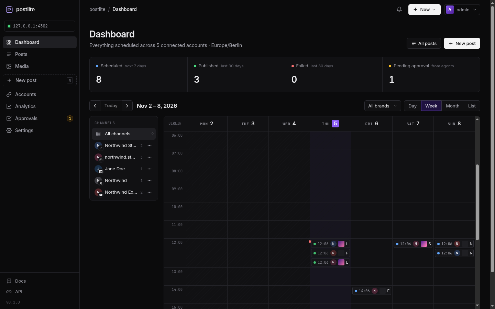
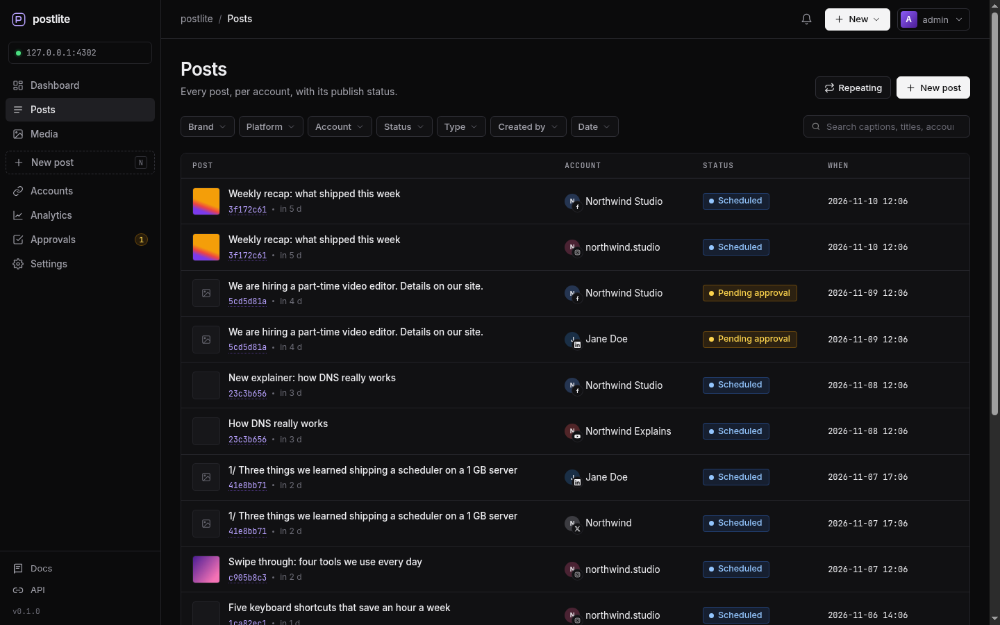
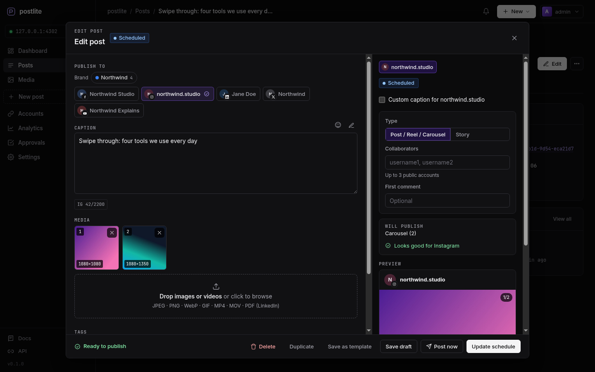
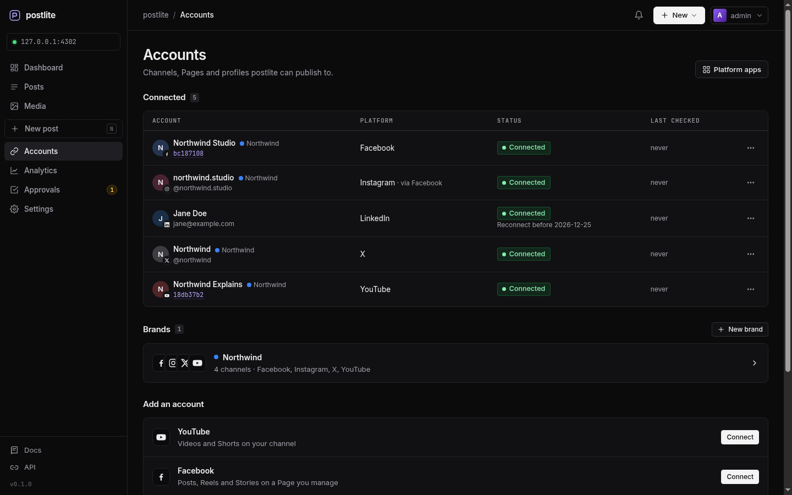
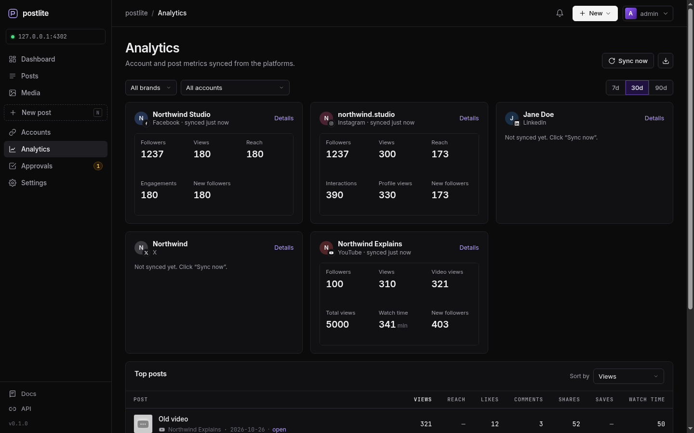
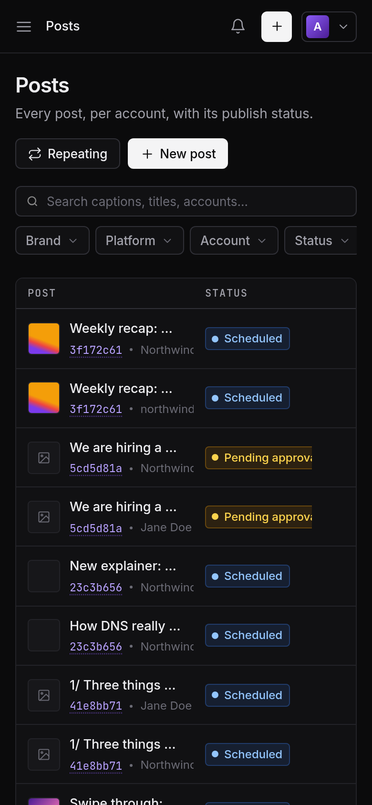

# postlite

A small, self-hosted social media scheduler for YouTube, Facebook Pages, Instagram, LinkedIn and X that you can drive from the web UI, a REST API, MCP or the command line.

postlite runs as one Node.js process with a SQLite file (about 70 MB of RAM, no runtime dependencies, no Docker), or entirely on Cloudflare's free plan (Workers, D1, R2 and Cron Triggers). Both builds share the same core.

[](https://deploy.workers.cloudflare.com/?url=https://github.com/muhammedilyasy/postlite)

| Calendar | Posts | Composer |
| --- | --- | --- |
|  |  |  |
| **Accounts and brands** | **Analytics** | **Mobile** |
|  |  |  |

The screenshots come from a local demo instance with made-up accounts.

## Features

- **Publishing** to YouTube (videos and Shorts), Facebook Pages (posts, photos, video, Reels, Stories), Instagram (posts, carousels, Reels, Stories), LinkedIn profiles and Company Pages (text, images, video, PDF documents) and X (posts, threads, media).
- **Calendar** with day, week, month and list views and drag-and-drop rescheduling.
- **Composer** with one caption plus per-channel overrides and settings, validation against each platform's limits, previews, threads, a first comment, an emoji picker, signatures and templates.
- **Brands**: named sets of channels, for example one brand's YouTube, Instagram, Facebook and X. Pick a brand to select all of its channels, and filter posts, the calendar and analytics by brand.
- **Tags**, **repeating posts** (daily, every few days, weekly, every two weeks, monthly) and posting slots for "next free slot" scheduling.
- **Media library** with resumable uploads. Originals can be deleted automatically after publishing (after a short safety window, after 7 or 30 days, or never); thumbnails and published links stay.
- **Approvals**: posts created by API keys in approval mode wait for a person to approve them.
- **Analytics**: followers, views, reach and engagement per account and per post, top posts and CSV export. YouTube falls back to the Data API when the Analytics API is off. Missing permissions show as "not available" with the fix, not as errors.
- **Alerts**: a notification bell plus optional email (SMTP or Resend) for failed posts, accounts that need reconnecting, published posts and a daily digest. Each person picks what they receive.
- **Workspaces**: with Cloudflare Access sign-in, every allowed email gets its own isolated workspace (accounts, posts, media, analytics, keys, webhooks, audit log and platform app credentials). Password mode has one owner workspace.
- **For agents and scripts**: a versioned REST API with an OpenAPI 3.1 spec, an MCP server (stdio and Streamable HTTP), a CLI, signed webhooks, an agent guide and `llms.txt`. API keys are scoped and rate limited, and every change lands in an audit log.
- **Scheduler**: atomic job claiming, persisted publish steps, crash recovery that checks with the platform before retrying, retries with backoff, and a grace window for posts missed while the server was down.

## Supported platforms

postlite publishes through developer apps that you create on each platform. Some features need a paid tier or an app review.

| Platform | Developer app | Paid tier | App review | Notes |
| --- | --- | --- | --- | --- |
| YouTube | Google Cloud project with an OAuth client | No | Not for your own channels (Google shows an "unverified app" screen) | Uploads come out of a daily quota. [Guide](docs/setup/youtube.md) |
| Facebook Pages | Meta app with Facebook Login | No | Only when people without a role on the app connect | [Guide](docs/setup/facebook-and-instagram.md) |
| Instagram, through a Facebook Page | The same Meta app | No | Same as Facebook | Business or Creator account linked to a Page. [Guide](docs/setup/facebook-and-instagram.md) |
| Instagram, with Instagram Login | Meta app with the Instagram product | No | Same as Facebook | Business or Creator account, no Page needed. [Guide](docs/setup/instagram-standalone.md) |
| LinkedIn profile | LinkedIn app with Share on LinkedIn and Sign In with OpenID Connect | No | No | Tokens last 60 days, then you reconnect. [Guide](docs/setup/linkedin.md) |
| LinkedIn Company Page | The same LinkedIn app | No | Yes, for the Community Management API | Also needed for first comments and analytics. [Guide](docs/setup/linkedin.md) |
| X | X developer app (OAuth 2.0) | Yes, pay-per-use API credits | No | Every request is billed, so postlite keeps reads to a minimum. [Guide](docs/setup/x.md) |

Enter credentials in **Settings → Platform apps** (stored encrypted) or set them in `.env` as a fallback. That page shows the exact redirect URIs for your instance. The guides are also served by your instance at `/docs/setup/`.

## Quick start (Node)

You need Node.js 22.13 or newer. There is nothing to install.

```sh
git clone https://github.com/muhammedilyasy/postlite.git && cd postlite
cp .env.example .env
node bin/postlite.js gen-secrets      # copy SESSION_SECRET and TOKEN_ENC_KEY into .env
$EDITOR .env                          # set PUBLIC_URL
node bin/postlite.js set-password     # admin password for the web UI
node bin/postlite.js start            # http://127.0.0.1:4100
```

postlite listens on 127.0.0.1. Put it behind HTTPS (`deploy/Caddyfile` or `deploy/nginx.conf`): Meta only fetches media from public HTTPS URLs, and Instagram needs HTTPS redirect URIs. `deploy/postlite.service` is a systemd user unit, and `deploy/backup.sh` takes a consistent snapshot of `data/` while the server runs. Keep `TOKEN_ENC_KEY` with your backups, because stored tokens are encrypted with it.

To sign in with Cloudflare Zero Trust Access (email one-time PIN) instead of a password, set `AUTH_MODE=cloudflare-access` and follow [docs/setup/cloudflare-access.md](docs/setup/cloudflare-access.md). postlite verifies the Access token itself and only admits the addresses in `ALLOWED_EMAILS`.

## Deploy to Cloudflare

The button at the top copies the repository to your account and deploys it. To do it by hand:

```sh
npm install && npx wrangler login
npx wrangler r2 bucket create postlite-media
npm run cf:deploy                                       # deploys and applies the D1 migrations
openssl rand -base64 32 | npx wrangler secret put TOKEN_ENC_KEY
openssl rand -base64 32 | npx wrangler secret put SESSION_SECRET
```

Then add a custom domain, the Access application with its bypass paths, and your platform apps. [docs/setup/cloudflare-workers.md](docs/setup/cloudflare-workers.md) covers each step and the free-plan limits that matter.

Differences from the Node build: posts go out up to a minute after their time (the cron runs every minute), video posters are made in the browser instead of with ffmpeg, and the stdio MCP server and CLI run on your machine and talk to the Worker over HTTPS.

## Agents and MCP

Agents can do everything the web UI does.

- **REST**: `https://postlite.example.com/api/v1/…`, with the OpenAPI spec at `/api/v1/openapi.json`.
- **MCP over HTTP**: `https://postlite.example.com/mcp` with an `Authorization: Bearer <api key>` header.
- **MCP over stdio**: `node bin/postlite.js mcp`. With `POSTLITE_URL` and `POSTLITE_API_KEY` set, it connects to a remote instance and can upload local files.
- **CLI**: `node bin/postlite.js posts create --content "Hello" --brand Northwind --next-slot --url https://postlite.example.com --key <api key>`. It talks to the API, so it works the same against Node and Workers instances.
- **Docs for agents**: [docs/agent-guide.md](docs/agent-guide.md) (served at `/AGENTS.md`) and `/llms.txt`. Configs for Claude Desktop, Claude Code, Cursor and Hermes are in [examples/agents/](examples/agents/).

Create keys in **Settings → API keys** or with `node bin/postlite.js keys create --name "Claude"`. New keys start in approval mode, so their posts wait for you. Approval-mode keys can't approve posts, raise their own permissions or change app credentials.

## Configuration

Everything is configured with environment variables. [.env.example](.env.example) lists them with a short explanation each. For the Workers build, see [.dev.vars.example](.dev.vars.example) and the `cloudflare.bindings` block in `package.json`. Platform app credentials can be kept in the database instead (Settings → Platform apps).

More documentation: [docs/](docs/README.md).

## FAQ

**What does it need to run?**
On Node, about 70 MB of RAM at idle and around 105 MB at peak while uploading a video. On Cloudflare it fits the free plan for personal use (Workers, D1, and R2's 10 GB free storage).

**What limits should I expect?**
The platforms set them. YouTube uploads come out of a daily API quota, Instagram allows 100 API-published posts per account in 24 hours, X bills every request, and LinkedIn tokens expire after 60 days unless your app is an approved partner. postlite checks each platform's media and caption rules before scheduling, so a post fails when you write it rather than when it is due.

**Can several people share one workspace?**
No. Each person gets their own workspace, and a page or channel can be connected in only one workspace at a time. There are no roles or shared workspaces yet.

**Is it tested against the real platform APIs?**
The test suite runs against local fake servers for every platform and never calls Meta, Google, X or LinkedIn. Try each platform with your own app before you rely on it.

**Why does Instagram reject my PNG?**
The Instagram API accepts JPEG images only. postlite tells you before scheduling instead of converting the file.

## Development

```sh
npm test                               # Node tests against the fake providers
npm install                            # dev dependency (wrangler) for the Workers build only
npm run test:workers                   # the real Worker in workerd with local D1 and R2
node test/fake/server.js --port 4199   # fake providers for manual testing
```

## Contributing

Bug reports and pull requests are welcome. Please read [CONTRIBUTING.md](CONTRIBUTING.md) first: the project keeps zero runtime dependencies, no build step, and one core for both Node and Workers.

## Notice

postlite is an independent implementation. [Postiz](https://github.com/gitroomhq/postiz-app) and the official platform documentation served as behavioural references only; no Postiz code is included. postlite is not affiliated with Meta, Google, X, LinkedIn or Postiz.

## License

[MIT](LICENSE)
